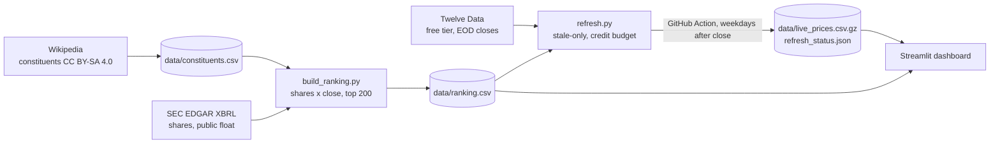

# S&P 500 Tracker: Top 200 by Market Cap, Real Closes

[](https://github.com/alfiochoa/sp500-tracker/actions/workflows/ci.yml) [](https://alfredo-sp500-tracker.streamlit.app/)

Sector weights, 1d/1w/1m/YTD returns, movers, momentum + volatility scores, 52-week-range position, a correlation
heatmap for any basket, and a watchlist with (mocked) webhook alerts and CSV export, in one Streamlit dashboard.

> **Coverage: the 200 largest S&P 500 constituents by market cap, every symbol with real end-of-day closes from Twelve Data
> (delayed, not real-time).** The other ~303 index members are not shown and have no prices here. **Nothing in the
> deployed app is simulated.** Not investment advice. No trading features.
> Constituent list from Wikipedia (CC BY-SA 4.0).

**Live demo:** https://alfredo-sp500-tracker.streamlit.app/ (verified with a headless-browser click-through; the page shows the last refresh time and how many symbols are fresh)


## Ranking method (what "top 200" means here)

`data/ranking.csv` (with `data/ranking_meta.json`) is committed and rebuilt by `scripts/build_ranking.py` (manually or quarterly via the *Rebuild ranking* workflow). Current ranking **as of 2026-10-13**.

1. **Universe:** the S&P 500 list from Wikipedia (503 tickers; several companies have two share classes).
2. **Shares outstanding:** SEC EDGAR XBRL API (free, no key, descriptive User-Agent with contact, <= 5 requests/s):
   `dei:EntityCommonStockSharesOutstanding` from each company's latest 10-K/10-Q cover page, all share classes summed.
   If a company only reports it per class (Alphabet, Meta), the latest balance-sheet or diluted weighted-average share count is
   used instead (`shares_basis` column says which).
3. **Price:** the Twelve Data close on one common date (2026-10-13) for every ranked symbol.
4. **Market cap = shares x close.** Pre-selection: pricing all ~503 names would cost ~503 API credits, so 309 candidates (the 300 largest by SEC
   `dei:EntityPublicFloat`, plus 9 that report no float) were priced and the final top 200 chosen by market cap. Check: the deepest
   float-rank among the final 200 is **277** of 300, i.e. the pre-selection margin is real but not huge: a very large company with
   unusually heavy insider ownership (so a small float) could in principle be missed. The #200 company is about **$56.8B**.
5. **Share-count quality** (`shares_basis` column): 179 cover-page counts, 6 balance-sheet, 12 diluted weighted-average (all classes) and
   3 estimates (`public_float_proxy`: BRK.B, V, C) where SEC offers no fresh figure: implied shares = public float / close on the float date
   (non-affiliate shares only, so slightly low for companies with large insiders). Stale figures (older than 200 days; e.g. Visa's 2010 cover page)
   are rejected rather than used.

**Limits:** share counts lag (the latest filing's cover date, `shares_date` in the file); companies with two share classes use the
company total, so both lines (e.g. GOOGL and GOOG) show the same cap; the ranking is an approximation of the index provider's
float-adjusted ranking, not a copy of it; STZ and VYLR had no usable SEC share data and are not ranked (a known gap); three companies (BRK.B, V, C) have no fresh share count and use the public-float estimate described below. If this ranking could not be built, the app would say "200 constituents with real
price data, selected by ..." instead of claiming the top 200.

## Architecture



## Data sources and their terms

| Source | Use | Terms |
|---|---|---|
| Wikipedia "List of S&P 500 companies" | constituents, sectors | CC BY-SA 4.0, attribution shown in the app and here. MediaWiki API with an identifying User-Agent; HTML fallback only if `robots.txt` allows it; cached 7 days. |
| SEC EDGAR XBRL API (`data.sec.gov`) | shares outstanding, public float | Public domain; SEC fair-access policy followed (descriptive User-Agent with contact, <= 10 requests/s; this project uses <= 5/s, only when the ranking is rebuilt). |
| [Twelve Data](https://twelvedata.com) free tier | daily closes (real, delayed) | Free key in `TWELVE_DATA_API_KEY`; 8 requests/min. Check their terms before redistributing data. |
| Yahoo (optional) | `YahooProvider(enabled=True)` | **Off by default.** Unofficial endpoint; Yahoo's ToS restricts automated use. Never enabled in CI or the demo. |

## Credits and refresh policy

The Twelve Data key is shared with another project, so this one self-limits to **<= 320 credits per weekday** (1 credit = 1 symbol request).
A weekday run costs at most 200 credits and usually fewer:

- skips the run when the US market is closed (weekends and NYSE holidays; built-in calendar, tested);
- fetches only symbols whose latest stored close is older than the last completed trading day, never refetches fresh ones,
  and asks only for the missing days;
- ignores in-progress (intraday) bars, so every stored value is a completed-session close;
- 8 requests/minute, daily counter in `data/refresh_state.json`, log line `twelvedata credits used: N`.

**Account-wide safety guard (`sp500/guard.py`).** A repo-local counter cannot see the other project's spending, so before every paid batch
(and every 25 calls inside it) the jobs read Twelve Data's free `api_usage` endpoint (spends no credits) and only spend while
`daily_usage + planned <= 560` of the 800/day free plan, so this project yields first. If `api_usage` cannot be read the jobs **fail
closed** (spend nothing, keep the previous data, exit 0 with a `::warning::`). The per-minute limit is checked with `current_usage`
(wait 62 s once, else keep the old data; a 429 mid-run gets one 62 s retry). Log line: `twelvedata account usage: N/800 before, M after`.
Tests, CI and the Streamlit app never call `api.twelvedata.com` (a test fixture fails any such request).

## Run it

```bash
pip install -r requirements-dev.txt
streamlit run streamlit_app.py            # real committed data, no key needed
pytest -q && ruff check .                 # offline, no key needed
SP500_SYNTHETIC=1 streamlit run streamlit_app.py   # dev only: SYNTHETIC test data, loudly labelled
TWELVE_DATA_API_KEY=... python scripts/refresh.py  # stale-only refresh (weekdays)
python scripts/build_ranking.py sec && python scripts/refresh.py --universe candidates && python scripts/build_ranking.py rank
```

Add the repo secret `TWELVE_DATA_API_KEY`; `.github/workflows/refresh.yml` runs weekdays at 22:30 UTC and commits the small data files.
Without the secret it exits cleanly and the app keeps the last committed real closes.

## Tests and engineering notes

pytest + ruff run in CI. The unit tests use a **synthetic** snapshot (`dev/synthetic_snapshot`, seeded random walks) that exists only for tests and
offline development; the deployed app never reads it. Covered: credit-budget logic, trading calendar, SEC share-class parsing, ranking
order, provider parsing/validation, API keys never logged, the app showing no simulated wording. Retries with backoff, timeouts,
token-spacing rate limiter, SQLite cache, pydantic validation, key=value structured logs. `sp500/constituents.py` fails loudly
(`StructureChanged`) if Wikipedia's table changes and keeps the last good cache.

## Limitations

- Top 200 only (see ranking limits above); the rest of the index has no prices here.
- Free tier: delayed daily closes, occasional gaps; scores are descriptive statistics, not forecasts.
- The webhook is mocked (shows the payload, sends nothing). Weights are market caps within the top-200 universe, not index-provider weights.

Built by Alfredo Ochoa, AI Automation & Data Integration. Code: MIT.
