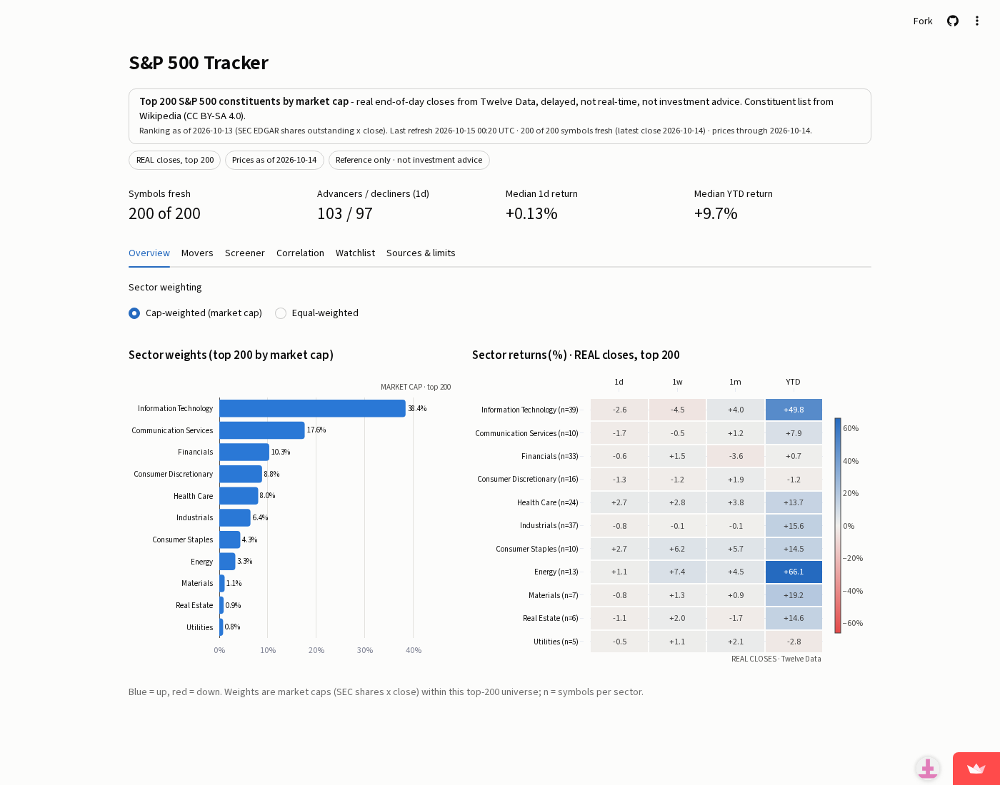
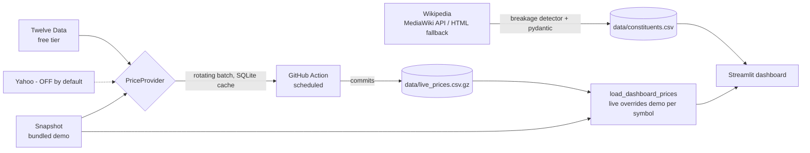

# S&P 500 Tracker & Analysis

[](https://alfredo-sp500-tracker.streamlit.app/)

Sector weights, 1d/1w/1m/YTD returns, movers, momentum + volatility scores, 52-week-range position, a correlation
heatmap for any basket, a watchlist with (mocked) webhook alerts and CSV export, in one Streamlit dashboard that **always
renders**: it ships with a bundled demo snapshot and upgrades symbol-by-symbol to live data as a scheduled GitHub Action
refreshes it.



> **SIMULATED demo prices - not real market data. Company list is scraped from Wikipedia.**
> Returns, movers, scores and alerts you see without a live feed are computed on seeded random walks
> (`scripts/make_snapshot.py`) attached to *real* company names, so e.g. a "+130% YTD" figure is not a real result.
> The UI shows a persistent SIMULATED banner and badge. Not investment advice. No trading features.

**Live demo:** https://alfredo-sp500-tracker.streamlit.app/ (live universe shown below: real Twelve Data closes for the symbols refreshed so far, the rest SIMULATED; verified with a headless-browser click-through)


> Live coverage grows ~40 symbols per scheduled run (8 runs per weekday, free-tier limits); full coverage in a few days.

## Architecture



## Data sources and their terms

| Source | Use | Terms |
|---|---|---|
| Wikipedia "List of S&P 500 companies" | constituents, sectors | CC BY-SA 4.0, attribution shown in the app and here. MediaWiki API with an identifying User-Agent; HTML fallback only if `robots.txt` allows it; cached 7 days. |
| [Twelve Data](https://twelvedata.com) free tier | daily closes | Free key in `TWELVE_DATA_API_KEY`; 8 req/min and 800/day respected by rate limiting and by rotating ~40 symbols per run across runs. Check their terms before redistributing data. |
| Bundled snapshot | tests, CI, offline demo | **SIMULATED** prices, generated here; the symbols/names/sectors are the real Wikipedia list (verified identical to the live table). |
| Yahoo (optional) | `YahooProvider(enabled=True)` | **Off by default.** Unofficial endpoint; Yahoo's ToS restricts automated use. Personal/educational use only; never enabled in CI or the demo. |

Market-cap weights are *illustrative orders of magnitude* in the snapshot, not index-provider weights.

## Run it

```bash
pip install -r requirements-dev.txt
streamlit run streamlit_app.py     # works offline, no key needed
pytest -q                          # offline, no key needed
TWELVE_DATA_API_KEY=... python scripts/refresh.py --batch 40   # optional live refresh
```

Live refresh in GitHub: add repo secret `TWELVE_DATA_API_KEY`; `.github/workflows/refresh.yml` runs 8x per weekday, commits
`data/live_prices.csv.gz` + `data/refresh_state.json`. Without the secret it exits cleanly with a `::warning::` that live mode is off, and the app keeps showing the SIMULATED banner.

## Engineering notes

Retries with backoff, timeouts, token-spacing rate limiter, SQLite cache, pydantic validation of every payload,
key=value structured logs, API keys never logged (tested). `sp500/constituents.py` fails loudly (`StructureChanged`) if
Wikipedia's table changes and keeps the last good cache.

## Limitations

- Until the scheduled job has cycled through all ~503 symbols, the dashboard mixes live and demo series (labelled per symbol).
- Free tiers: daily closes only, delays/gaps possible; scores are descriptive statistics, not forecasts.
- The webhook is mocked (shows the payload, sends nothing). Index weights are illustrative.

Built by Alfredo Ochoa, AI Automation & Data Integration. Code: MIT.
